<h1> こんにちは 👋✨ </h1>

  

<h3>🧐 About Me</h3>

I'm  <b>Lyi.</b> from China.

  
🎓 I’m a <b>Software Technology undergraduate student</b> 📚, focusing on <b>Application Software & System Development</b> ⚙️.

  
💻 Alongside development, I’m also studying <b>Computer Networking</b> 🌐 and <b>Cloud Computing</b> ☁️ technologies.

  
🎶 I’m a big fan of <b>Anime (aka. ACG)</b> 🌸 and <b>VOCALOID</b> 🎧, which inspire both my creativity and side projects.

  
🚀 I enjoy turning ideas into practical systems, exploring how software works at scale, and continuously learning new things ✨.

### 📊 My Stats

  <picture>
    <source media="(prefers-color-scheme: dark)" srcset="./images/stats-dark.svg" />
    <source media="(prefers-color-scheme: light)" srcset="./images/stats-light.svg" />
    
  </picture>
  <picture>
    <source media="(prefers-color-scheme: dark)" srcset="./images/langs-dark.svg" />
    <source media="(prefers-color-scheme: light)" srcset="./images/langs-light.svg" />
    
  </picture>

### 🛠️ My Skills

### 🎧 Interests

- 🎵 VOCALOID & digital music culture  
- 🌌 Anime / ACG culture  
- ⚙️ Exploring new tech stacks  
- ☁️ Cloud-native & distributed systems  

> *“Code, connect, and create — powered by curiosity and creativity.”* ✨
